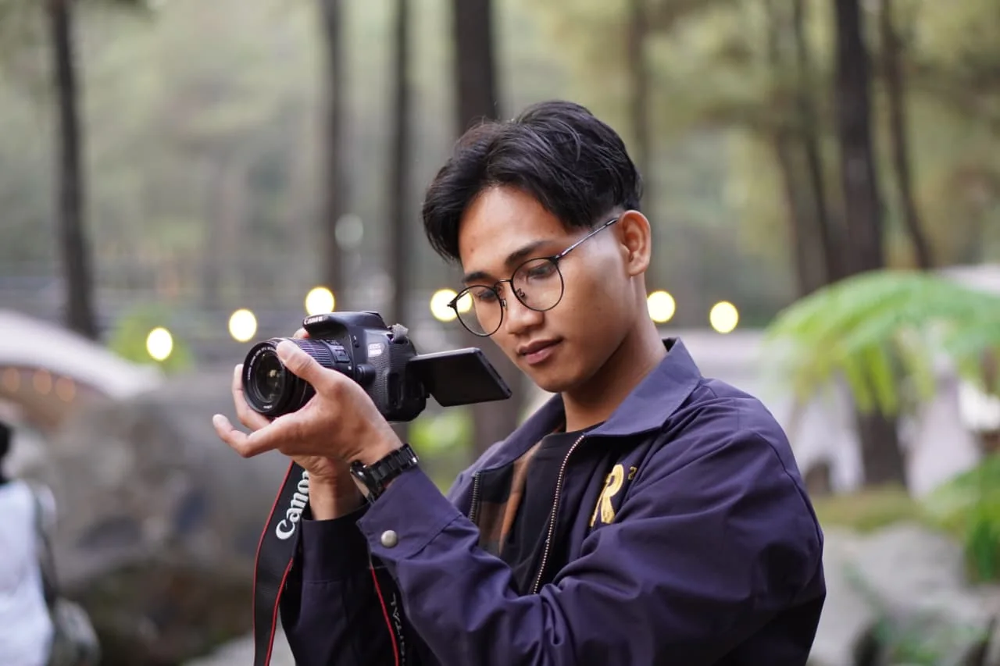

# Malik Adnan — Portfolio

Website portofolio statis untuk Malik Adnan (graphic designer). HTML + CSS + JavaScript,
tanpa build step dan tanpa dependency. Referensi layout: [premier-portfolio](https://github.com/israelmitolu/premier-portfolio).

## Struktur

```
malikadnan-portofolio/
├── index.html
├── assets/
│   ├── css/style.css
│   ├── js/app.js
│   ├── cv/Malik-Adnan-CV.docx
│   ├── fonts/               <- The Historia Demo (font display)
│   └── img/
│       ├── malik-camera.webp <- foto Malik
│       ├── activities/       <- foto kegiatan sosial/kampus
│       ├── hero-sample.svg   <- poster contoh (placeholder)
│       ├── work-1..6.svg     <- gambar karya (placeholder)
│       └── favicon.svg
└── README.md
```

## Nuansa visual

Tampilan mengikuti bahasa visual [mitolu.dev](https://www.mitolu.dev/): intro dengan
tombol "Jelajahi" + dua panel warna yang menyapu layar, kursor lensa (invert),
bentuk geometris yang berputar, nama besar dengan gradient, kartu "Halo 👋"
yang membuka saat di-hover/diklik, dan project box dengan bayangan warna offset.

- Nama memakai **The Historia Demo** (file asli dari repo referensi, lisensi
  "Demo / Personal Use Only"); teks UI memakai Archivo dan judul bagian
  Space Grotesk. Font UI dimuat dari Google Fonts.
- Intro menunggu tombol **Jelajahi** ditekan; tidak ditutup otomatis. Kalau tidak
  ingin intro sama sekali, hapus blok
  `<div class="intro">` dan dua `<div class="slider">` di `index.html`.
- Topbar (logo, navigasi, toggle tema) selalu terlihat; latarnya muncul setelah
  melewati hero. Navigasi punya penanda section aktif (scrollspy).
- Tombol **Salin** di bagian kontak menyalin alamat email ke clipboard.
- Hero memakai ilustrasi poster contoh di `assets/img/hero-sample.svg` agar
  bidang visual tidak kosong; ganti dengan proyek Malik sebelum publikasi.
- Galeri `#kegiatan` memakai foto asli dari folder Downloads. Wajah siswi di
  foto pendampingan disamarkan; pastikan izin publikasi foto peserta lain.

## Ganti foto & gambar karya

Foto profil dan galeri kegiatan sudah memakai foto asli. Poster hero dan enam
gambar di galeri karya masih placeholder.

1. Simpan foto baru ke `assets/img/`.
2. Ubah `src` pada elemen gambar di `index.html` ke nama file baru:

```html

```

Rasio yang dipakai: foto kegiatan dan karya 4:3.
Ukuran ideal: sisi terpanjang ≤ 1600 px, dikompres di bawah ~300 KB per gambar.

Judul dan kategori tiap karya ada di blok `.project-box__content` pada `index.html`.

Kartu karya sengaja bukan link karena belum ada halaman detail. Kalau nanti
karya punya tautan (Behance, Instagram, halaman proyek), ubah `<article class="project-box">`
menjadi `<a class="project-box" href="URL" target="_blank" rel="noopener">` dan
tutup dengan `</a>`.

## Ganti teks

Semua konten ada langsung di `index.html`:

| Bagian | Lokasi |
| --- | --- |
| Nama, tagline, CTA | `#hero` |
| Bio + statistik | `#tentang` |
| Foto kegiatan | `#kegiatan` |
| Layanan | `#layanan` |
| Karya | `#karya` |
| Pengalaman | `#pengalaman` |
| Keahlian & pelatihan | `#keahlian` |
| Kontak | `#kontak` |

Warna ada di `:root` pada `assets/css/style.css` (ubah `--mainColor` untuk warna
aksen, `--green-alt` untuk kartu Halo dan panel intro).

## Preview lokal

```bash
cd /mnt/d/MintFz-Research/malikadnan-portofolio
python3 -m http.server 8080
```

Buka <http://localhost:8080>.

## Deploy ke GitHub Pages

```bash
cd /mnt/d/MintFz-Research/malikadnan-portofolio
git init -b main
git add .
git commit -m "Portofolio Malik Adnan"
git remote add origin https://github.com/<username>/<repo>.git
git push -u origin main
```

Lalu di repo GitHub: **Settings → Pages → Source: Deploy from a branch → main / (root)**.

## Catatan yang perlu dicek

- **Email**: CV menulis `mlikadnn21@gmail.com` (tanpa huruf "a" setelah "ml"). Kalau itu typo, perbaiki di `index.html` bagian `#kontak` dan di CV.
- **Tools desain**: CV belum menyebut software (Canva, Figma, Photoshop, Illustrator, dll). Belum ditambahkan ke website supaya tidak mengklaim yang tidak ada. Kalau memang dikuasai, tambahkan sebagai chip di bagian `#keahlian`.
- **Karya**: 6 kartu karya diturunkan dari pengalaman di CV. Ganti judul/kategori/gambar dengan karya asli sebelum dipublikasikan.
